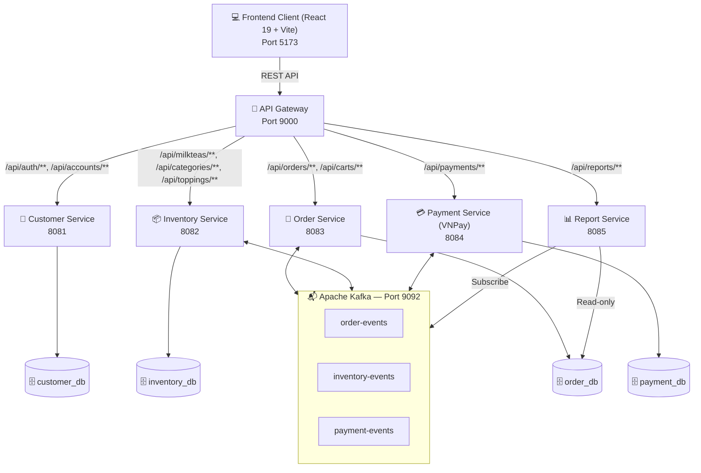
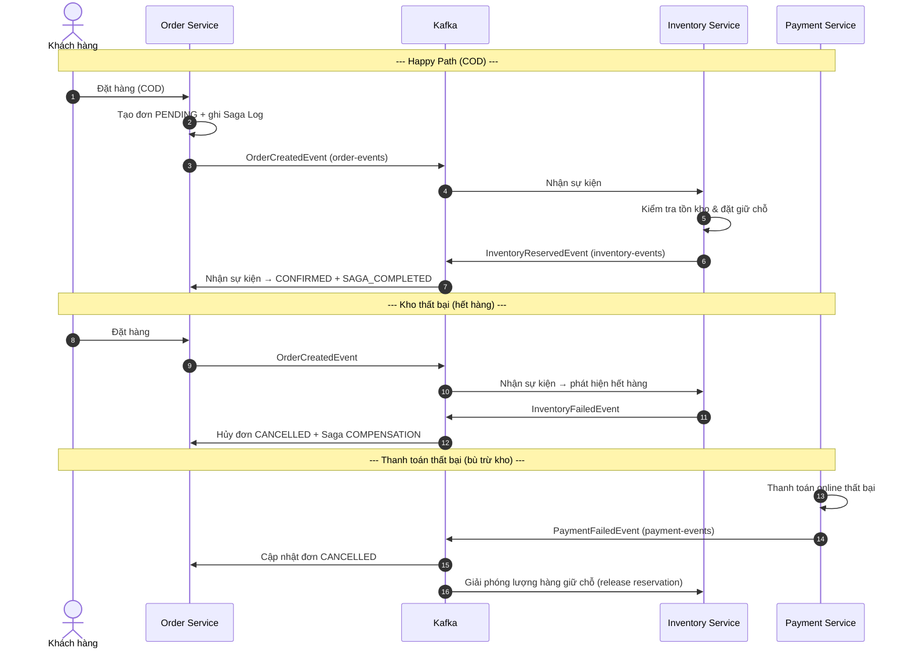

# 🧋 Shop_MilkTea — Hệ thống Đặt hàng Trà sữa trực tuyến theo Kiến trúc Microservices

> **Đồ án môn học:** MSS301 — Kiến trúc Hướng Dịch vụ (Service-Oriented Architecture & Microservices)
> **Sinh viên thực hiện:** Nguyễn Thành Long — **MSSV:** DE190477 — Đại học FPT

---

## 📌 1. Tổng quan

**Shop_MilkTea** là hệ thống thương mại điện tử bán trà sữa trực tuyến, được thiết kế theo **Kiến trúc Microservices** kết hợp **Event-Driven Architecture (EDA)**.

Điểm cốt lõi của dự án là giải quyết bài toán **giao dịch phân tán** giữa các service độc lập (Đặt hàng – Kho hàng – Thanh toán) bằng **Saga Choreography Pattern** trên message broker **Apache Kafka**, kèm cơ chế **bù trừ (compensation)** để đảm bảo tính nhất quán dữ liệu.

---

## ✨ 2. Tính năng chính

### 🍵 Phân hệ khách hàng
- Trang chủ, thực đơn với tìm kiếm, lọc sản phẩm.
- Tùy chỉnh kích cỡ (Nhỏ/Vừa/Lớn) và topping (trân châu đen, pudding, thạch củ năng...) — giá tự động tính theo size + topping.
- Giỏ hàng thời gian thực.
- Đặt hàng với 2 hình thức thanh toán:
  - **COD** (thanh toán khi nhận hàng).
  - **VNPay Sandbox** (quét QR / thẻ ngân hàng), redirect về `/payment/vnpay-return` sau khi thanh toán.
- Tra cứu lịch sử đơn hàng và trạng thái xử lý theo thời gian thực.
- Đăng ký / đăng nhập bảo mật bằng **JWT**.

### 🛡️ Phân hệ quản trị (Admin)
- **Dashboard thống kê:** doanh thu, số đơn, đơn hủy, biểu đồ xu hướng doanh thu, top món bán chạy, cơ cấu phương thức thanh toán.
- **Quản lý thực đơn & kho:** danh mục, sản phẩm, size, topping; bật/tắt trạng thái mở bán, cập nhật giá.
- **Quản lý đơn hàng & Saga Logs:** theo dõi đơn toàn hệ thống, giám sát chuỗi sự kiện Saga từng bước (`RESERVE_INVENTORY`, `PROCESS_PAYMENT`, `COMPENSATION`, `SAGA_COMPLETED`).
- **Quản lý tài khoản:** khóa/kích hoạt, phân vai trò (`ADMIN`, `STAFF`, `CUSTOMER`).

---

## 🏗️ 3. Kiến trúc & Công nghệ

### 3.1. Tech Stack

| Thành phần | Công nghệ |
| :--- | :--- |
| Backend | **Java 21**, **Spring Boot 4.1.1**, Spring Cloud Gateway (WebMVC), Spring Cloud OpenFeign |
| Cơ sở dữ liệu | **MySQL 8.4**, Spring Data JPA, Hibernate, **Flyway** migration |
| Message broker | **Apache Kafka 3.8.0** (KRaft mode, không phụ thuộc Zookeeper) |
| Bảo mật | Spring Security, **JWT (JJWT)**, BCrypt |
| Thanh toán | **VNPay Payment Gateway** (Sandbox) |
| Frontend | **React 19**, **Vite 8**, React Router v7, Bootstrap 5 + React-Bootstrap, Axios |
| Triển khai | Docker, Docker Compose (multi-stage Dockerfile cho từng service) |

### 3.2. Sơ đồ kiến trúc tổng thể



Mỗi service tuân theo mẫu hình **Database-per-Service**; riêng **Report Service** chỉ **đọc (read-only)** dữ liệu thống kê từ `order_db` và đồng bộ thời gian thực qua Kafka.

---

## 🔄 4. Saga Choreography — Giao dịch phân tán



---

## 🗄️ 5. Danh mục Microservices

| Dịch vụ | Cổng | Database | Trách nhiệm |
| :--- | :---: | :--- | :--- |
| **API Gateway** | `9000` | — | Định tuyến request, xác thực/decode JWT, forward `X-User-Id` / `X-Username` / `X-User-Role`, cấu hình CORS. |
| **Customer Service** | `8081` | `customer_db` | Đăng ký/đăng nhập, phát hành JWT, quản lý tài khoản & vai trò. |
| **Inventory Service** | `8082` | `inventory_db` | Danh mục, sản phẩm, size, topping; kiểm soát tồn kho & giữ chỗ (`InventoryReservation`). |
| **Order Service** | `8083` | `order_db` | Giỏ hàng, đơn hàng, điều phối Saga, lưu vết `SagaLog`. |
| **Payment Service** | `8084` | `payment_db` | Thanh toán COD & **VNPay Sandbox**, lịch sử giao dịch, phát sự kiện thanh toán. |
| **Report Service** | `8085` | `order_db` *(read-only)* | Tổng hợp số liệu, API phân tích phục vụ Dashboard; đồng bộ qua Kafka. |
| **Frontend Web** | `5173` | SPA | Giao diện khách hàng & quản trị (React 19 + Vite). |

---

## ⚙️ 6. Cài đặt & Khởi chạy

### 6.1. Yêu cầu
- **Docker Desktop** (cách khuyến nghị) **hoặc**: JDK 21, Node.js 20+ / npm, Docker (chỉ để chạy MySQL + Kafka).

### 6.2. Cách 1 — Chạy toàn bộ hệ thống bằng Docker Compose (khuyến nghị ⚡)

```bash
cd Shop_MilkTea_Service
docker compose up -d --build      # Build & chạy: MySQL + Kafka + 6 services + Frontend
# hoặc chỉ hạ tầng nếu muốn chạy backend thủ công:
# docker compose up -d mysql kafka
```

Hệ thống sẽ khởi động:
- MySQL 8.4 (port `3306`) — tự tạo 5 database độc lập qua `mysql/init.sql`.
- Apache Kafka 3.8 KRaft (port `9092`, 3 partitions mỗi topic).
- 6 service backend: `8081` → `8085`, gateway `9000`.
- Frontend React qua nginx (port `5173` → container port `80`).

Giới hạn tài nguyên: mỗi backend `~350M` (order-service `450M`, gateway `300M`), MySQL/Kafka `450–500M`, frontend `64M`.

**Dừng hệ thống:**

```bash
docker compose down        # Dừng container
docker compose down -v     # Dừng + Xóa dữ liệu MySQL (reset về đầu)
```

### 6.3. Cách 2 — Chạy thủ công từng phần

**Bước 1 — Hạ tầng Docker (MySQL & Kafka):**

```bash
cd Shop_MilkTea_Service
docker compose up -d mysql kafka
```

**Bước 2 — Các microservices** (mỗi terminal một thư mục trong `Shop_MilkTea_Service`):

```bash
./mvnw spring-boot:run
```
| Thư mục | Cổng |
| :--- | :---: |
| `customer-service` | 8081 |
| `inventory-service` | 8082 |
| `order-service` | 8083 |
| `payment-service` | 8084 |
| `api-gateway` | 9000 |
| `report-service` (tùy chọn) | 8085 |

**Bước 3 — Frontend:**

```bash
cd Shop_MilkTea
npm install
npm run dev
```
> Frontend đọc địa chỉ API Gateway qua biến môi trường `VITE_API_BASE_URL` — cấu hình trong `.env` (xem `.env.example`, mặc định `http://localhost:9000`).

### 6.4. Kiểm thử API với Postman

Bộ collection + environment dựng sẵn:
```text
Shop_MilkTea_Service/postman/Shop_MilkTea.postman_collection.json
Shop_MilkTea_Service/postman/Shop_MilkTea.postman_environment.json
```
Import cả hai file vào Postman để test toàn bộ API qua Gateway.

---

## 🔑 7. Tài khoản thử nghiệm

Các tài khoản được seed qua Flyway migration, mật khẩu chung: **`password123`**

| Tên đăng nhập | Mật khẩu | Vai trò | Trạng thái | Ghi chú |
| :--- | :--- | :---: | :---: | :--- |
| `admin_db` | `password123` | ADMIN | ACTIVE | Toàn quyền quản trị. |
| `staff1` | `password123` | STAFF | ACTIVE | Nhân viên vận hành. |
| `customer1` | `password123` | CUSTOMER | ACTIVE | Khách hàng đặt món. |
| `customer2` | `password123` | CUSTOMER | ACTIVE | Tài khoản kiểm thử #2. |
| `inactive_user` | `password123` | CUSTOMER | INACTIVE | Mô phỏng tài khoản bị khóa / chưa kích hoạt. |

Ngoài ra, Customer Service cấu hình thêm một tài khoản admin dự phòng in-memory: `admin` / `admin123`.

---

## 🌐 8. Đường dẫn truy cập chính

| Trang | URL |
| :--- | :--- |
| 🏠 Trang chủ khách hàng | http://localhost:5173 |
| 🍵 Thực đơn | http://localhost:5173/menu |
| 🛒 Giỏ hàng | http://localhost:5173/cart |
| 📦 Lịch sử đơn hàng | http://localhost:5173/orders |
| 💳 VNPay Return | http://localhost:5173/payment/vnpay-return |
| 📊 Admin — Dashboard | http://localhost:5173/admin/dashboard |
| 🍵 Admin — Quản lý thực đơn | http://localhost:5173/admin/menu |
| 📑 Admin — Đơn hàng & Saga Logs | http://localhost:5173/admin/orders |
| 👥 Admin — Tài khoản | http://localhost:5173/admin/accounts |
| 🌐 API Gateway | http://localhost:9000 |

---

## 📁 9. Cấu trúc thư mục

```text
DE190477_MSS301_project/
├── README.md                        # Tài liệu mô tả dự án
├── DE_CUONG_DU_AN.md                # Đề cương dự án
├── docs/                            # Tài liệu báo cáo (project_V2.docx)
│
├── Shop_MilkTea/                    # Frontend (React 19 + Vite)
│   ├── .env.example                 # Mẫu biến môi trường (VITE_API_BASE_URL)
│   ├── Dockerfile / nginx.conf      # Build & serve qua nginx (Docker)
│   ├── index.html / vite.config.js
│   └── src/
│       ├── component/               # Component UI dùng chung (Navbar, Footer, Modals, Cards)
│       ├── context/                 # State Context API (Auth, Cart, Order, Inventory)
│       ├── layout/                  # MainLayout, AdminLayout
│       ├── page/                    # Trang khách hàng (Landing, Menu, Cart, Orders)
│       │   └── admin/               # Trang Admin (Dashboard, Menu, Orders, Accounts)
│       ├── router/                  # AppRouter (React Router v7)
│       └── service/                 # Axios HTTP client gọi API qua Gateway
│
└── Shop_MilkTea_Service/            # Backend Microservices (Spring Boot)
    ├── docker-compose.yml           # Toàn bộ hạ tầng + 6 service + frontend
    ├── mysql/
    │   └── init.sql                 # Khởi tạo 5 database độc lập
    ├── postman/                     # Collection & environment test API
    ├── api-gateway/                 # Spring Cloud Gateway (9000)
    ├── customer-service/            # Auth & tài khoản (8081)
    ├── inventory-service/           # Thực đơn & kho (8082)
    ├── order-service/               # Đơn hàng & Saga (8083)
    ├── payment-service/             # Thanh toán COD + VNPay (8084)
    └── report-service/              # Báo cáo thống kê (8085)
```

---

## 👨‍💻 10. Tác giả

- **Nguyễn Thành Long** — MSSV `DE190477`
- Học phần: `MSS301` — Kiến trúc Hướng Dịch vụ, Đại học FPT
- © 2026 — Dự án phục vụ mục đích học tập và nghiên cứu.
