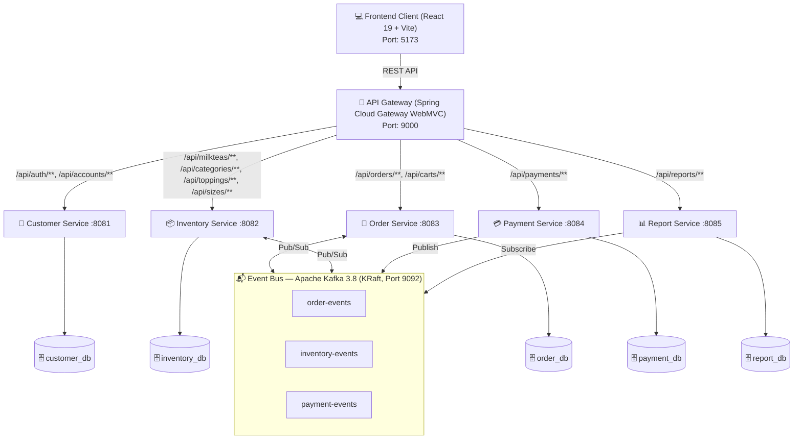
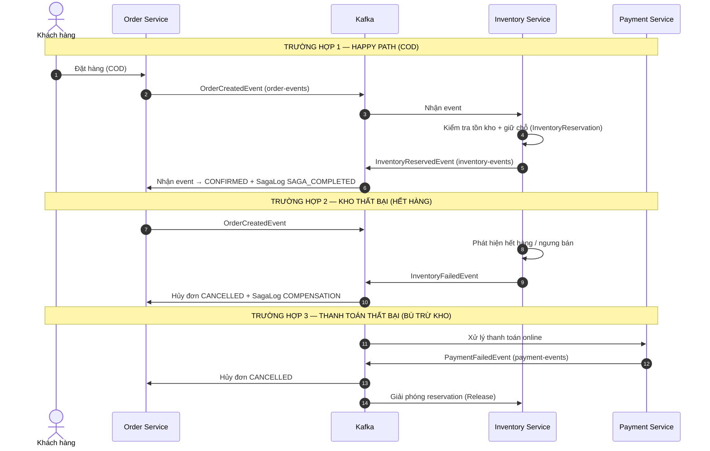

# 📋 BÁO CÁO TỔNG QUAN DỰ ÁN — Report_project

> **Tên dự án:** Shop_MilkTea — Hệ Thống Đặt Hàng Trà Sữa Trực Tuyến Phân Tán (Microservices)
> **Môn học:** MSS301 — Kiến trúc Hướng Dịch vụ (SOA & Microservices)
> **Sinh viên thực hiện:** Nguyễn Thành Long — **DE190477**
> **Trường:** Đại học FPT
> **Thời điểm viết báo cáo:** 09/11/2026 (quét toàn bộ source code hiện hành, branch chính sau merge `docker/docker-compose`)

---

## 1. Giới Thiệu Tổng Quan

**Shop_MilkTea** là một hệ thống thương mại điện tử chuyên biệt cho mô hình chuỗi cửa hàng bán lẻ trà sữa trực tuyến, được thiết kế và triển khai hoàn toàn theo phong cách **Kiến trúc Microservices** kết hợp **Kiến trúc Hướng Sự Kiện (Event-Driven Architecture — EDA)**.

Bài toán cốt lõi mà dự án giải quyết là **giao dịch phân tán** giữa các dịch vụ độc lập (Đặt hàng — Kho bãi — Thanh toán) bằng cách áp dụng **Mô hình Saga (Saga Choreography Pattern)** qua message broker **Apache Kafka**, đảm bảo tính toàn vẹn và nhất quán dữ liệu (Data Consistency & Compensation).

Dự án phục vụ mục đích học tập, minh họa đầy đủ các khái niệm: Database-per-Service, API Gateway, JWT Authentication, Saga + Compensation, CQRS, Event-Driven Sync, Automated Migration (Flyway) và tối ưu hiệu năng frontend.

### Phạm vi hệ thống gồm 2 phân hệ chính:

| Phân hệ | Đối tượng | Chức năng chính |
|---|---|---|
| **Khách hàng (Customer)** | CUSTOMER | Xem thực đơn, tùy chọn size/topping, giỏ hàng, đặt hàng, thanh toán COD/VNPay, tra cứu đơn hàng |
| **Quản trị (Admin) & Nhân viên (Staff)** | ADMIN / STAFF | Dashboard thống kê, báo cáo kinh doanh, quản lý thực đơn & kho, quản lý đơn hàng + giám sát Saga Logs, quản lý tài khoản, màn hình POS tại quầy |

---

## 2. Kiến Trúc Tổng Thể

### 2.1. Sơ đồ kiến trúc



### 2.2. Tech Stack

| Lớp | Công nghệ |
|---|---|
| Backend | Java 21, Spring Boot 4.1.1, Spring Cloud 2025.1.3, Spring Cloud Gateway (WebMVC) |
| Database & Persistence | MySQL 8.4, Spring Data JPA / Hibernate, Flyway Migration, HikariCP |
| Message Broker | Apache Kafka 3.8 (KRaft mode, không Zookeeper), spring-kafka |
| Giao tiếp service-to-service | OpenFeign (InventoryClient, OrderClient), sự kiện Kafka |
| Security | Spring Security OAuth2 Resource Server (Gateway), Nimbus JWT (HS256), BCrypt |
| Frontend | React 19.2, Vite 8, React Router v7, Bootstrap 5 / React-Bootstrap, Axios |
| Container & DevOps | Docker (multi-stage build), Docker Compose (full-stack), nginx:1.27-alpine, script `run.bat` / `stop.bat` |
| Testing | JUnit 5, Mockito (inline mock maker), Spring Boot Test |

---

## 3. Danh Mục Microservices (Backend: `Shop_MilkTea_Service/`)

Mỗi service áp dụng chặt chẽ nguyên tắc **Database-per-Service**, schema riêng biệt, khởi tạo 100% qua **Flyway Migration** (`ddl-auto=none`, riêng payment-service đang dùng `update`).

| # | Service | Port | Database | Vai trò |
|---|---|---:|---|---|
| 1 | **api-gateway** | 9000 | — | Định tuyến bằng RouterFunction, xác thực JWT (resource server), extract identity từ token và forward header `X-User-Id`, `X-Username`, `X-User-Role`, cấu hình CORS |
| 2 | **customer-service** | 8081 | `customer_db` | Đăng ký/đăng nhập, phát hành JWT (HS256), quản lý tài khoản & vai trò (ADMIN/STAFF/CUSTOMER), audit trail |
| 3 | **inventory-service** | 8082 | `inventory_db` | Quản lý danh mục (CategoryTea), sản phẩm (MilkTea), size (TeaSize), topping (Topping); kiểm soát tồn kho + giữ chỗ `InventoryReservation`; tham gia Saga qua Kafka |
| 4 | **order-service** | 8083 | `order_db` | Quản lý giỏ hàng (Cart, CartItem), đơn hàng (Order, OrderItem); **trung tâm điều phối Saga** và lưu vết `SagaLog`; recovery job định kỳ |
| 5 | **payment-service** | 8084 | `payment_db` | Tạo link thanh toán VNPay (HMAC-SHA512), xử lý IPN callback, lưu `PaymentTransaction`, phát sự kiện thanh toán |
| 6 | **report-service** | 8085 | `report_db` | Read-model đơn hàng (ReportOrder, ReportOrderItem) — mô hình **CQRS**: đồng bộ qua Kafka + OpenFeign; cung cấp API dashboard, xuất CSV |
| 7 | **frontend** | 5173 | — (SPA) | Ứng dụng React 19 đóng gói bằng nginx (Docker) |

### 3.1. Chi tiết REST API từng service

**API Gateway (9000)** — `Routes.java` định tuyến 5 nhóm path tới 5 service downstream; `UserHeaderFilter` chuyển tiếp user identity; `SecurityConfig` bảo vệ bằng JWT.

**Customer Service (8081)**
- `AuthController` `/api/auth`: `POST /login`, `POST /register`
- `AccountController` `/api/accounts`: CRUD tài khoản + `PUT /{id}/password`
- Thành phần: `JwtService` (Nimbus HS256), `AuthService`, `AccountService`, `PasswordConfig` (BCrypt), `AuditHeaderInterceptor` + `AuditContext` (audit created_by/updated_by từ header forwarded)
- Migration: `V1__create_t_accounts.sql`, `V2__seed_test_accounts.sql` (seed 5 tài khoản thử nghiệm)

**Inventory Service (8082)**
- 4 controller CRUD đầy đủ: `/api/milkteas`, `/api/categories`, `/api/sizes`, `/api/toppings`
- **Saga participation:**
  - `InventoryEventListener` — nghe `order-events` (OrderCreated → giữ chỗ; OrderCancelled → hoàn kho) và `payment-events` (PaymentFailed → release kho; PaymentSuccess → xác nhận xuất kho)
  - `InventoryEventProducer` — phát `InventoryReservedEvent` / `InventoryFailedEvent` lên `inventory-events`
- **Saga logic:** `InventoryReservationService.reserveInventory()` — idempotent theo `orderCode`, kiểm tra `isAvailable` + đủ `stockQuantity`, trừ kho và tạo reservation trạng thái `RESERVED`
- `KafkaConfig` có `DefaultErrorHandler` + `FixedBackOff` (xử lý retry consumer)
- Migration: 5 file (V1→V5, gồm seed dữ liệu menu và bảng reservation)

**Order Service (8083) — trung tâm Saga**
- `OrderController` `/api/orders`: `POST` (tạo đơn → khởi động Saga), `GET /my`, `GET /{orderCode}`, `GET /{orderCode}/saga-logs`, `GET` (admin tìm kiếm phân trang + filter), `PUT /{orderCode}/status`, `PUT /{orderCode}/payment-status`, `PUT /{orderCode}/cancel`, `POST /{orderCode}/compensate`
- `CartController` `/api/carts`: CRUD giỏ hàng theo index
- **Saga logic (OrderService):**
  - Create order → publish `OrderCreatedEvent` (`order-events`)
  - Nghe `inventory-events`: InventoryReserved → COD: `CONFIRMED` + SAGA_COMPLETED; online: chờ payment (EXECUTING). InventoryFailed → **compensation** (hủy đơn)
  - Nghe `payment-events`: PaymentSuccess → `CONFIRMED` + `PAID`; PaymentFailed → compensation
  - **Compensation có Retry 3 lần** (Spring `RetryTemplate`); cờ demo `saga.demo.simulate-compensation-failure` để mô phỏng lỗi bù trừ
  - `OrderSagaRecoveryService`: `@Scheduled` (60s) quét saga treo `COMPENSATING` và tự khôi phục
- **Chống gian lận giá:** `PriceVerificationService` dùng OpenFeign (`InventoryClient`) xác minh giá sản phẩm/size/topping phía server trước khi tạo đơn
- Migration: 3 file (order tables, saga log, saga status)

**Payment Service (8084)**
- `PaymentController` `/api/payments`: `POST /create` (tạo URL VNPay hoặc COD), `GET /vnpay-ipn` (callback IPN), `GET /{orderCode}/status`
- `PaymentServiceImpl` + `VNPayConfig`/`VNPayUtil`: build URL, ký HMAC-SHA512, verify checksum IPN → publish `PaymentSuccessEvent`/`PaymentFailedEvent`
- `OrderClient` (Feign) gọi ngược `PUT /api/orders/{orderCode}/payment-status`

**Report Service (8085) — mô hình CQRS**
- `ReportController` `/api/reports`: `GET /dashboard`, `/summary`, `/revenue-trend`, `/top-selling`, `/order-status`, `/payment-methods`, `GET /export/orders/csv`
- Read-model: `ReportOrder`, `ReportOrderItem` trong `report_db`
- `ReportEventListener` — nghe `order-events` + `payment-events` (groupId `report-group`) để upsert/update trạng thái thời gian thực
- `ReportSyncService` + `OrderClient` (OpenFeign) — đồng bộ ban đầu toàn bộ đơn hàng khi khởi động (nếu report_db trống), hỗ trợ full-replay
- Migration: `V1__create_report_tables.sql`

---

## 4. Mô Hình Saga Choreography (Apache Kafka)

### 4.1. Các Topic & Sự kiện

| Topic | Producer | Consumer | Sự kiện |
|---|---|---|---|
| `order-events` | Order Service | Inventory, Report | `OrderCreatedEvent`, `OrderCancelledEvent`, `OrderStatusUpdatedEvent` |
| `inventory-events` | Inventory Service | Order | `InventoryReservedEvent`, `InventoryFailedEvent` |
| `payment-events` | Payment Service | Order, Inventory, Report | `PaymentSuccessEvent`, `PaymentFailedEvent` |

Key của message = `orderCode`; payload dạng JSON; consumer group tương ứng: `order-group`, `inventory-group`, `payment-group`, `report-group`.

### 4.2. Ba kịch bản giao dịch



**Điểm mạnh thiết kế:** Saga log chi tiết từng bước (`RESERVE_INVENTORY`, `PROCESS_PAYMENT`, `COMPENSATION`, `SAGA_COMPLETED`), cơ chế bù trừ tự động có retry, recovery job cho saga treo, idempotent reservation chống xử lý trùng.

---

## 5. Frontend (`Shop_MilkTea/` — React 19 + Vite 8)

Quy mô: **~80 file source (`src/`), ~14.600 dòng code**, cấu trúc phân lớp rõ ràng.

### 5.1. Trang & định tuyến (AppRouter.jsx — React Router v7)

| Đường dẫn | Trang | Phân quyền |
|---|---|---|
| `/` | LandingPage (trang chủ: hero, promo, menu nổi bật) | Public |
| `/menu` | MenuPage (thực đơn, tùy chọn size/topping) | Public |
| `/cart` | CartPage | Public |
| `/orders` | OrderPage (lịch sử, chi tiết theo dõi đơn) | ProtectedRoute (yêu cầu đăng nhập) |
| `/payment/:orderCode` | PaymentPage (màn hình QR thanh toán) | Public |
| `/payment/vnpay-return` | PaymentReturnPage (kết quả callback VNPay) | Public |
| `/staff/pos` | StaffPosPage (POS gọi món tại quầy) | Guard role STAFF/ADMIN |
| `/admin/dashboard` | AdminDashboardPage (KPI tổng quan) | Guard role ADMIN |
| `/admin/report` | AdminReportPage (biểu đồ doanh thu, CSV export) | Guard ADMIN |
| `/admin/menu` | AdminMenuPage (CRUD menu + kho) | Guard ADMIN |
| `/admin/orders` | AdminOrderPage (quản lý đơn + **Saga Logs Monitor**) | Guard ADMIN |
| `/admin/accounts` (+ `/:id/change-password`) | Quản lý tài khoản, đổi mật khẩu | Guard ADMIN |
| `/admin`, `*` | Chuyển hướng về `/admin/dashboard` / `/` | — |

**Route Guards:** `ProtectedRoute`, `AdminRoute` (chỉ ADMIN), `StaffRoute` (STAFF/ADMIN) — hiển thị cảnh báo "Truy Cập Bị Từ Chối" nếu không đủ quyền, spinner khi đang load auth.

### 5.2. Quản lý trạng thái (State Management)

Kiến trúc **Context API + useReducer**, 6 domain: `Auth`, `Cart`, `Inventory`, `Order`, `Account`, `Report` — mỗi domain gồm:
- `XContext.js` (createContext) + `XProvider.jsx` (provider, gọi service)
- `XReducer.js` (`src/reduce/`) — reducer handlers
- Custom hooks `useX` (`src/hook/`)
- 7 Axios service module (`src/service/`) — mọi request đi qua `axiosClient.js` (baseURL `VITE_API_BASE_URL` = API Gateway :9000, tự gắn Bearer token, tự logout khi 401)

### 5.3. Component & tiện ích

- **Layouts:** `MainLayout` (khách hàng: Header glassmorphism + Footer), `AdminLayout` (Sidebar + Topbar)
- **Components (6 nhóm, 22 file):** `auth/` (guards, LoginModal đăng nhập/đăng ký), `common/` (Header, Footer, PageLoadingFallback), `landing/` (Hero, FeaturedMenu, PromoBanner, FAQ, ProductDetailModal…), `cart/` (CartDrawer, CartItemRow, CartSummaryCard), `order/` (OrderCard, OrderDetailModal, OrderFilterTabs, CancelOrderModal)
- **Validation (`src/validation/`):** `authValidation` (email RFC, SĐT VN, username), `accountValidation`, `menuValidation` — validation thủ công phía client
- **Utils:** `formatPrice` (VND), `orderUtils` (mapping nhãn/màu/badge theo OrderStatus)

### 5.4. Đóng gói & phục vụ

- `Dockerfile` 2-stage: `node:20-alpine` build (npm ci có cache mount, bake `VITE_API_BASE_URL` vào bundle lúc build) → `nginx:1.27-alpine` phục vụ `dist/`
- `nginx.conf`: SPA fallback (`try_files → /index.html`), gzip, cache tĩnh bất biến 30 ngày cho JS/CSS/ảnh

---

## 6. Hạ Tầng & Triển Khai (DevOps)

### 6.1. Docker Compose (full-stack — 9 container)

| Container | Image / Build | Port | Giới hạn RAM |
|---|---|---|---:|
| mysql | `mysql:8.4` (init 5 DB từ `mysql/init.sql`) | 3306 | 450M |
| kafka | `apache/kafka:3.8.0` (KRaft single-node) | 9092 | 450M |
| api-gateway | build Dockerfile (multi-stage Maven + JRE 21 alpine) | 9000 | 300M |
| customer-service | idem | 8081 | 350M |
| inventory-service | idem | 8082 | 350M |
| order-service | idem | 8083 | 384M |
| payment-service | idem | 8084 | 350M |
| report-service | idem | 8085 | 350M |
| frontend | build `../Shop_MilkTea` | 5173 | 64M |

Tất cả Java service cấu hình `JAVA_OPTS` giới hạn heap (SerialGC, MaxMetaspace 160M) + `restart: unless-stopped` + healthcheck; MySQL tune innodb_buffer_pool=128M, max_connections=50; chuẩn logging json-file (10MB × 3).

### 6.2. Script tự động hóa (Windows)

- **`run.bat`** — 1 click: bật Docker (MySQL + Kafka), chờ cổng sẵn sàng, khởi động lần lượt 5 backend service + API Gateway + Frontend
- **`stop.bat`** — giải phóng toàn bộ cổng (8081–8085, 9000, 5173) và tắt container an toàn

---

## 7. Cơ Sở Dữ Liệu

- **MySQL 8.4**, utf8mb4; `mysql/init.sql` tạo 5 DB độc lập: `customer_db`, `inventory_db`, `order_db`, `payment_db`, `report_db`
- Mỗi service dùng **Flyway** với bảng history riêng (`*_flyway_history`)
- Các bảng chính:
  - `customer_db`: `t_accounts` (+ audit columns created_at/by, updated_at/by)
  - `inventory_db`: `t_milk_teas`, `t_category_teas`, `t_tea_sizes`, `t_toppings`, `t_inventory_reservations`
  - `order_db`: `t_carts`, `t_cart_items`, `t_orders`, `t_order_items`, `t_saga_logs`
  - `payment_db`: `t_payment_transactions`
  - `report_db`: `t_orders`, `t_order_items` (read-model CQRS)
- Seed dữ liệu: 5 tài khoản thử nghiệm (Flyway V2), menu/kho (inventory V2–V5)

### Tài khoản thử nghiệm (mật khẩu chung: `password123`)

| Tài khoản | Vai trò | Trạng thái |
|---|---|---|
| `admin_db` | ADMIN | ACTIVE |
| `staff1` | STAFF | ACTIVE |
| `customer1`, `customer2` | CUSTOMER | ACTIVE |
| `inactive_user` | CUSTOMER | INACTIVE (mô phỏng tài khoản bị khóa) |

---

## 8. Trạng Thái Kiểm Thử (Testing)

| Service | Unit test | Ghi chú |
|---|---:|---|
| api-gateway | 1 | Context loads |
| customer-service | 1 | Context loads, 0 test nghiệp vụ |
| inventory-service | 1 | Context loads, 0 test nghiệp vụ |
| order-service | ~28 | Có Controller/Service test (Cart, Order, PriceVerification) |
| payment-service | 1 | Context loads |
| report-service | 21 | **100% PASS** — bao phủ Controller, Listener, Sync |
| Frontend (React) | 0 | Chưa có test runner (Vitest/Jest) |

> **Lưu ý:** báo cáo audit trước đó (tháng 10/2026) ghi nhận `order-service` có 3 test FAIL (2 NPE do thiếu `@Mock Kafka Producer`, 1 context fail do kết nối MySQL); các commit sau đó (`InventoryReservationService` mockable, cấu hình test profile/report-service có `application.properties` riêng cho test) đã khắc phục một phần — report-service 21/21 PASS. Customer/Inventory/Payment vẫn thiếu test nghiệp vụ.

---

## 9. Đánh Giá Chất Lượng (tổng hợp từ PROJECT_QUALITY_AUDIT_REPORT + code hiện hành)

### 9.1. Scorecard

| Hạng mục | Điểm | Trạng thái hiện hành |
|---|---:|---|
| Kiến trúc Microservices | 8.0/10 | ✅ Database-per-service 100%; report-service CQRS (Kafka + Feign sync) |
| Backend Code & Saga Pattern | 7.0/10 | ⚠️ Saga + retry + recovery hoạt động tốt; còn vị trí cần cải thiện (xem 9.3) |
| Bảo mật & Cấu hình | 4.5/10 | 🚨 Secret còn hardcode trong repo |
| Kiểm thử tự động | 2.5/10 | 🚨 Test nghiệp vụ chủ yếu tập trung ở order & report; các service còn lại rất ít |
| Frontend Code Quality | 8.5/10 | ✅ 0 lỗi ESLint; còn God Component lớn |
| DevOps & Triển khai | 5.0 → 7.0/10 | ⬆️ **Đã cải tiến:** đủ 7 Dockerfile + docker-compose full-stack (trước audit: 0 Dockerfile) |
| **Tổng thể** | **~7.0/10** | 📈 Tiến bộ rõ rệt so với audit cũ (6.8) |

### 9.2. Những điểm đã hoàn thành nổi bật

- ✅ **Database-per-Service triệt để** + Flyway chuẩn hóa, từng service có bảng history riêng
- ✅ **Saga Choreography hoàn chỉnh** với 3 kịch bản (happy path, kho fail, payment fail), compensation có retry + recovery job định kỳ, reservation idempotent
- ✅ **CQRS tại Report Service**: read-model riêng + Kafka realtime + Feign full-sync ban đầu + endpoint `sync` chủ động; 21/21 tests PASS
- ✅ **Chống gian lận giá** server-side (PriceVerification qua Feign)
- ✅ **Full containerization**: Dockerfile multi-stage cho 6 service + frontend nginx; docker-compose chạy toàn hệ thống 1 lệnh, giới hạn RAM chặt chẽ chống OOM
- ✅ **Quản trị vận hành**: healthcheck, restart policy, logging chuẩn, script `run.bat`/`stop.bat`
- ✅ Frontend: 0 lỗi ESLint/React-Hooks, phân quyền route (`AdminRoute`/`StaffRoute`/`ProtectedRoute`), validation đầy đủ client-side

### 9.3. Điểm còn tồn đọng (Roadmap khuyến nghị)

**Ưu tiên cao (🔴)**
1. **Chống bán vượt kho (Overselling):** `MilkTea` chưa có `@Version`/Pessimistic Lock → race condition khi 2 đơn giữ chỗ đồng thời (Lost Update)
2. **Secrets còn hardcode trong Git:** JWT secret, MySQL password, VNPay hash-secret → cần chuyển sang biến môi trường / `.env`
3. **Bảo vệ dịch vụ nội bộ:** các service 8081–8085 chưa chặn request gọi trực tiếp (bypass Gateway) → cần filter header bí mật `X-Gateway-Secret`
4. Đồng bộ tài khoản admin giữa `run.bat` (`admin_db/password123`) và cấu hình in-memory (`admin/admin123`)

**Ưu tiên trung (🟡)**
5. **Chuẩn hóa Event Contract:** phân giải event đang dùng duck-typing (`root.has("items")`) → nên thêm trường `eventType` hoặc Kafka header
6. payment-service chưa có `@KafkaListener` (luồng thanh toán vẫn REST-triggered → chưa EDA toàn diện)
7. Thiếu Circuit Breaker / Cache cho lời gọi Feign đồng bộ (PriceVerification) → rủi ro cascading failure
8. Tái cấu trúc God Component (`AdminMenuPage` ~1.200 dòng, `StaffPosPage` ~1.000 dòng)
9. ~~Router dùng static imports~~ → **Đã khôi phục:** `React.lazy()` + `<Suspense>` cho toàn bộ 13 trang trong `AppRouter.jsx` — bundle chính giảm từ **709 kB → 321 kB** (~8 lần nhỏ hơn mức cảnh báo 500 kB của Vite), mỗi trang thành chunk độc lập 5–36 kB
10. ~~97 lỗi ESLint/React Hooks~~ → **Đã xử lý dứt điểm (11/2026):** khi kiểm tra thực tế, các fix "0 lỗi" trong audit cũ cũng bị mất khi merge; đã quét lại toàn bộ — xóa unused imports/vars ở ~40 file, chuyển reset state trong `LoginModal`/`ProductDetailModal` sang sự kiện `onShow` của Modal, chuẩn hóa pattern data-fetching trong `PaymentPage`/`PaymentReturnPage` (setState sau await + cleanup flag), chuẩn hóa deps của `CartProvider`/`PaymentPage` theo React Compiler. Kết quả hiện tại: **`npm run lint` = 0 lỗi, 0 cảnh báo**
10. payment-service nên đồng bộ `ddl-auto=update` → `none` theo chuẩn Flyway dùng chung

**Ưu tiên thấp (🟢)**
11. Thiếu Root Maven Parent POM (quản lý dependency tập trung; `BaseEntity`, `AuditContext`, Event DTO đang copy-paste giữa các service)
12. Thiếu CI/CD (GitHub Actions) và Distributed Tracing (Zipkin/Jaeger)
13. Bổ sung unit test cho Customer/Inventory/Payment; thêm test runner cho frontend; Swagger/OpenAPI

---

## 10. Hướng Dẫn Chạy Dự Án Nhanh

```bash
# Cách 1: Script tự động (Windows)
run.bat          # MySQL + Kafka + 5 services + Gateway + Frontend
stop.bat         # Dừng toàn bộ

# Cách 2: Docker Compose full-stack
cd Shop_MilkTea_Service
docker compose up -d --build

# Cách 3: Chạy thủ công
docker compose up -d                    # infra
# ... từng service: ./mvnw spring-boot:run (8081→8085, 9000)
cd ../Shop_MilkTea && npm install && npm run dev   # frontend dev-mode :5173
```

**Truy cập chính:**
- Khách hàng: http://localhost:5173 (thực đơn `/menu`, giỏ `/cart`, đơn `/orders`)
- Quản trị: http://localhost:5173/admin/dashboard
- POS nhân viên: http://localhost:5173/staff/pos
- API Gateway: http://localhost:9000

---

## 11. Kết Luận

**Shop_MilkTea** là một dự án đồ án hoàn chỉnh và có tính sư phạm cao, thể hiện thành công toàn bộ vòng đời của một hệ thống microservices thực chiến:

1. **Kiến trúc đúng chuẩn:** 6 microservices + API Gateway, Database-per-Service 100%, Flyway migration, JWT bảo mật tập trung tại Gateway.
2. **Saga Choreography là điểm sáng kỹ thuật:** giải quyết giao dịch phân tán bằng Kafka với đầy đủ 3 kịch bản thành công/thất bại/bù trừ, kèm Saga Log giám sát, retry compensation và recovery job — hiếm có ở đồ án sinh viên.
3. **CQRS thực dụng:** report-service tách read-model riêng, đồng bộ realtime qua EDA + fallback Feign sync.
4. **Vận hành được thật:** full Docker hóa, giới hạn tài nguyên, healthcheck, script 1-click.
5. **Hướng phát triển tiếp theo** tập trung vào 4 mặt: chống race condition tồn kho, bảo mật secrets & nội bộ, chuẩn hóa event contract, và mở rộng độ bao phủ kiểm thử + CI/CD + distributed tracing.

---

*Tài liệu này được tổng hợp sau khi quét toàn bộ dự án: source backend (6 Spring Boot services), frontend React (~80 file/14.6k LOC), docker-compose, Dockerfile, Flyway migrations, cấu hình application properties, tài liệu README/PROJECT_DESCRIPTION/PROJECT_QUALITY_AUDIT_REPORT và lịch sử Git.*

**© 2026 — Nguyễn Thành Long (DE190477), Đại học FPT. Dự án phục vụ mục đích học tập và nghiên cứu.**
